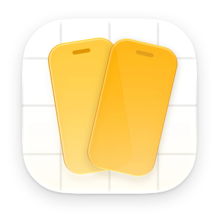
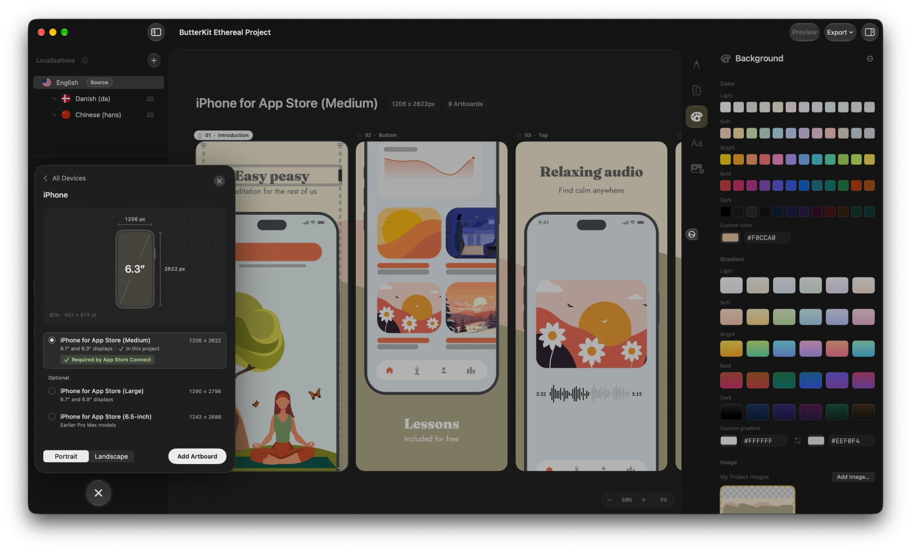
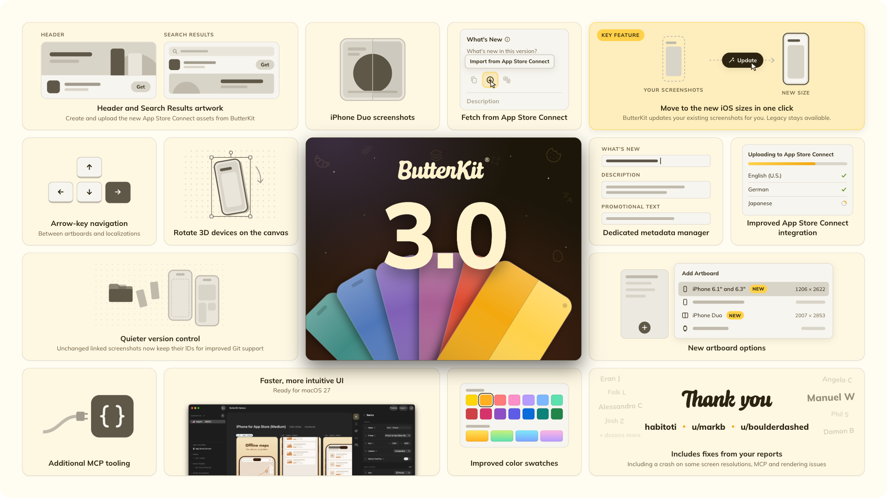
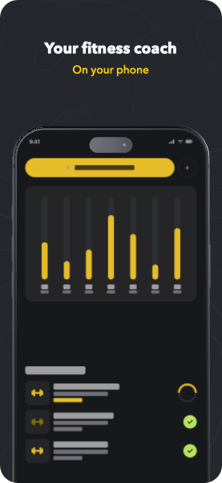
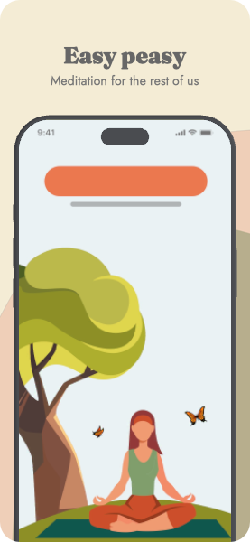
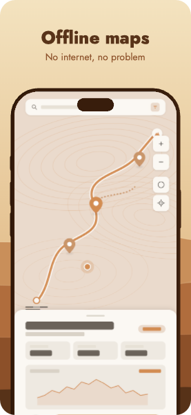
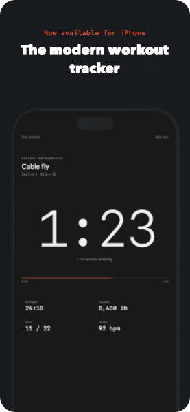
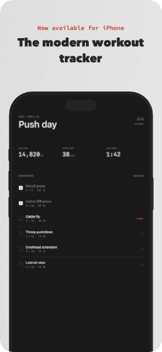

<p align="center">
  
</p>

<h1 align="center">ButterKit</h1>

<p align="center">
  The native Mac app for App Store screenshots. Design once, translate into all 50 App Store languages, and publish straight to App Store Connect.
</p>

<p align="center">
  <a href="https://butterkit.app/download?utm_source=github"><picture>
    <source media="(prefers-color-scheme: dark)" srcset="https://img.shields.io/badge/Download_free-FEF7E2?style=for-the-badge">
    
  </picture></a>
  <a href="https://apps.apple.com/app/id6751829199"><picture>
    <source media="(prefers-color-scheme: dark)" srcset="https://img.shields.io/badge/Mac_App_Store-2C2410?style=for-the-badge">
    
  </picture></a>
</p>

<p align="center">
  
  
  
  
</p>

<p align="center">
  <a href="https://butterkit.app?utm_source=github">Website</a> ·
  <a href="https://butterkit.app/docs?utm_source=github">Docs</a> ·
  <a href="https://butterkit.app/templates?utm_source=github">Templates</a> ·
  <a href="https://butterkit.app/changelog?utm_source=github">Changelog</a> ·
  <a href="https://reddit.com/r/butterkit">r/butterkit</a> ·
  <a href="https://discord.gg/UZ3SqSYDrV">Discord</a>
</p>

<br>

<p align="center">
  
</p>

<p align="center">
  
</p>

## Why ButterKit

**10 screenshots × 50 languages = 500 designs.** Then you ship an update and start over.

With ButterKit you design those 10 once. It translates them into every App Store language, keeps all 500 in sync as you make changes, and publishes the whole set to App Store Connect in one step.

| | Legacy design tools | AI image generators | **ButterKit** |
| --- | :---: | :---: | :---: |
| Fast results |  |  |  |
| No accounts or signups |  |  |  |
| Translates into 50 languages |  |  |  |
| Editable 3D devices |  |  |  |
| Capture from Xcode |  |  |  |
| Upload to App Store Connect |  |  |  |
| Full design control |  |  |  |
| Fastlane automation |  |  |  |

## What it does

- **Capture from Xcode.** Import screenshots from Xcode's Device Hub into 3D device frames.
- **Every App Store size.** iPhone, iPad, Mac, Apple Watch, Apple TV, Apple Vision Pro and iPhone Duo. Move existing screenshots to new sizes in one click.
- **Translate into 50 languages.** On-device translation is free. Add your own cloud API key to cover every App Store language.
- **Publish to App Store Connect.** Preview your listing, edit metadata, and upload screenshots plus Header and Search Results artwork without leaving the app.
- **Link your folders.** Point ButterKit at a Fastlane or build output folder, and screenshots refresh when the files change.
- **AI agents (MCP).** A built-in MCP server lets Claude, Cursor or Codex in ChatGPT design, translate and publish through ButterKit.
- **Native and local.** Built with SwiftUI and RealityKit, running on your Mac. Your designs never pass through a ButterKit server.
- **Open, Git-friendly files.** A `.butterkit` document is a folder of plain JSON and your images. Unchanged linked screenshots keep their files, so Git only sees images that really changed. The [format guide](format/README.md) shows how to get readable diffs.

## One-time purchase available

Pro is available as a one-time Lifetime license that doesn't expire, or as a Supporter plan. It removes the export watermark and adds App Store Connect publishing. The free version includes the design tools and templates, with watermarked exports. Education, veteran and first responder discounts are 50% off. [See pricing](https://butterkit.app/pricing?utm_source=github).

## Free templates

Start from a finished design. Every template is free, works in the free version of ButterKit, and adapts to every size and language.

| Ascent | Ethereal | Sahara | Minimalist Dark | Minimalist Light |
| :---: | :---: | :---: | :---: | :---: |
| <a href="https://butterkit.app/templates/ascent/?utm_source=github"></a> | <a href="https://butterkit.app/templates/ethereal/?utm_source=github"></a> | <a href="https://butterkit.app/templates/sahara/?utm_source=github"></a> | <a href="https://butterkit.app/templates/minimalist-dark/?utm_source=github"></a> | <a href="https://butterkit.app/templates/minimalist-light/?utm_source=github"></a> |
| [Get template](https://butterkit.app/templates/ascent/?utm_source=github) | [Get template](https://butterkit.app/templates/ethereal/?utm_source=github) | [Get template](https://butterkit.app/templates/sahara/?utm_source=github) | [Get template](https://butterkit.app/templates/minimalist-dark/?utm_source=github) | [Get template](https://butterkit.app/templates/minimalist-light/?utm_source=github) |

Browse every template at [butterkit.app/templates](https://butterkit.app/templates?utm_source=github).

## Connect your AI agent

ButterKit ships with an MCP server, so any agent that speaks the [Model Context Protocol](https://modelcontextprotocol.io) can work in your documents.

1. In ButterKit, open **Settings > MCP** and turn it on.
2. Add ButterKit to your tool's MCP config. This works for Claude Code and Cursor:

   ```json
   {
     "mcpServers": {
       "butterkit": {
         "command": "/Applications/ButterKit.app/Contents/MacOS/butterkit-mcp"
       }
     }
   }
   ```

   For Codex, including Codex in the ChatGPT app, add this to `~/.codex/config.toml` instead:

   ```toml
   [mcp_servers.butterkit]
   command = "/Applications/ButterKit.app/Contents/MacOS/butterkit-mcp"
   ```

3. Ask for what you want:

   > Use ButterKit to add Italian to my screenshots, translate them, and upload them to App Store Connect.

> [!TIP]
> ButterKit does not need to be open when your agent starts. The first tool call launches it for you. See the [MCP docs](https://butterkit.app/docs/mcp/?utm_source=github) for the full tool list and setup for other clients.

## What's in this repository

This repository holds the MCP bridge source, a guide to the document format, automation examples, the changelog and the public issue tracker.

| Folder | What it is |
| --- | --- |
| [`mcp/`](mcp) | Source for `butterkit-mcp`, the small bridge your AI tool launches. Read exactly what runs on your Mac, or build it yourself. |
| [`format/`](format) | How a `.butterkit` document is laid out, with a real sample document and a reader script |
| [`examples/`](examples) | A fastlane lane, linked folder layouts and agent prompts |
| [`CHANGELOG.md`](CHANGELOG.md) | Every release, mirrored from [butterkit.app/changelog](https://butterkit.app/changelog?utm_source=github) |

**Signed and sandboxed.** ButterKit runs in Apple's App Sandbox. The download from butterkit.app is signed with an Apple Developer ID and notarized by Apple, so macOS verifies it before it opens. The Mac App Store version is reviewed and signed by Apple.

## Bugs and ideas

This is ButterKit's public issue tracker.

- **Found a bug?** [Open a bug report](../../issues/new?template=bug_report.yml). Include your ButterKit version (**ButterKit > About ButterKit**), your macOS version and the steps to reproduce. A sample `.butterkit` file helps most.
- **Want something?** [Request a feature](../../issues/new?template=feature_request.yml), or add a thumbs up to an existing request. Reactions help decide what gets built next.
- **Private matters** like licenses, billing or your unreleased app go to [help@butterkit.app](mailto:help@butterkit.app). Please keep screenshots of unreleased apps out of public issues.

## What developers say

<p align="center">
  &nbsp;
  <b>4.7 out of 5</b> on the Mac App Store, from 74 ratings
</p>

<table>
  <tr>
    <td colspan="2" align="center">
      <br>
      “Every time I link to an App Store screenshot preparation tool, I find myself wishing, ‘well, it'd be perfect if it just did …’. I had no such thoughts when I checked out ButterKit. <b>It's really good.</b>”
      <br><br>
      <sub><b>Dave Verwer</b><br>iOS Dev Weekly</sub>
      <br><br>
    </td>
  </tr>
  <tr>
    <td width="50%" valign="top">
      “ButterKit made my listings look like a designer touched them, without me having to become one.”
      <br><br>
      <sub><b>Michael Watkins</b><br>Founder of Vibe Worker</sub>
    </td>
    <td width="50%" valign="top">
      “ButterKit is so versatile. Creating screenshots, uploading App Store Connect metadata, localization, it does it all.”
      <br><br>
      <sub><b>David Bireta</b><br>Developer, Cubefreecoder.com</sub>
    </td>
  </tr>
  <tr>
    <td width="50%" valign="top">
      “ButterKit is the first app I've seen that can generate really good results with relatively little effort. It was an insta-buy.”
      <br><br>
      <sub><b>Mark Smith</b><br>Founder of Mosey Parker</sub>
    </td>
    <td width="50%" valign="top">
      “My conversion rates have improved substantially with ButterKit.”
      <br><br>
      <sub><b>enclavedev</b><br>Developer</sub>
    </td>
  </tr>
  <tr>
    <td width="50%" valign="top">
      “ButterKit is, by far, the best app for this. It has sped up my workflow 100x.”
      <br><br>
      <sub><b>@paulboyce</b><br>Reddit</sub>
    </td>
    <td width="50%" valign="top">
      “I've tried 10 tools for this and ButterKit is the best.”
      <br><br>
      <sub><b>Cinematographer7</b><br>Reddit</sub>
    </td>
  </tr>
</table>

Read more at [butterkit.app/reviews](https://butterkit.app/reviews?utm_source=github), or share your own on [r/butterkit](https://reddit.com/r/butterkit).

## Also from ButterKit

**[ButterKit Motion](https://butterkit.app/motion?utm_source=github)** is a Mac app that turns screen recordings into product videos, with 3D camera moves, callouts, music and AI narration.

## About

I'm Zach Spitulski, and I build ButterKit out of my small garage in Los Angeles. I'm a dad, a hiker and backpacker, and a design engineer. ButterKit is self-funded and built by one developer.

<br>

<p align="center">
  <sub>The code, docs and examples in this repo are <a href="LICENSE">MIT licensed</a>, so feel free to use them, change them and build on them.<br>
  That covers this repo only, not the ButterKit app itself or the ButterKit name and logo. ButterKit® is a registered trademark.</sub>
</p>
