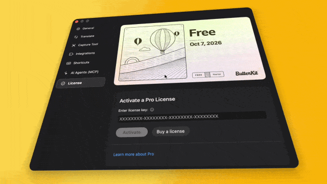

# Foil card

<p align="center">
  
</p>

The holographic license card from ButterKit's **Settings > License**, as a SwiftUI package. It has four parts:

- **`.foilSticker(_:)`** puts a rainbow foil with a diamond pattern and grain on any view, plus a highlight and a tilt that follow the pointer.
- **`FoilCard`** builds a card in the order that keeps the foil clean: your artwork and overlays, a hairline edge, the rounded clip, one flattened layer, then the foil.
- **`.foilCardSweep()`** is the transition that plays when Pro unlocks. The new card sweeps in over the old one on a soft diagonal edge.
- **`YearStamps`** draws a passport-style stamp for each year since a date.

Requires macOS 14 or iOS 17. The tilt and highlight follow a mouse or trackpad pointer, so on iPhone the card shows the foil without moving.

## Try it

```bash
cd source/foil-card
swift run FoilCardDemo
```

The demo shows a sample card with sliders for the foil settings and a toggle that plays the unlock sweep. You can also open `Package.swift` in Xcode and run the **FoilCardDemo** scheme.

## Add it to your project

Drag this folder into your Xcode project, then add the **FoilCard** library to your target under **Frameworks, Libraries, and Embedded Content**. It can't be added by URL, because it lives in a subfolder of this repo.

You can also copy the five files in [`Sources/FoilCard`](Sources/FoilCard) into your app target. The shaders then build into your app's default Metal library, and the code finds them there.

## Usage

```swift
import FoilCard

FoilCard {
    Image("ProCard")
        .resizable()
        .scaledToFit()
        .overlay {
            // Anything drawn here gets the same foil and tilt as the artwork.
        }
}
.shadow(color: .black.opacity(0.16), radius: 14, y: 6)
.padding(24) // Room for the hover lift and tilt.
```

`FoilCard` uses `FoilStickerStyle.card`. Any other view can take the effect on its own:

```swift
Image("Sticker")
    .foilSticker() // Sticker's default look
```

### Unlock sweep

Keep both cards in one `ZStack`, with the locked card below:

```swift
ZStack {
    if !isPro {
        FoilCard { freeArtwork }
            .transition(.asymmetric(insertion: .identity, removal: .foilCardHold))
    }
    if isPro {
        FoilCard { proArtwork }
            .transition(.asymmetric(insertion: .foilCardSweep(), removal: .opacity))
    }
}
.animation(.snappy(duration: 0.25), value: isPro)
.shadow(color: .black.opacity(0.16), radius: 14, y: 6)
.padding(24)
```

Put the shadow on the stack, not on each card, or it doubles during the sweep. When both artworks share a layout, the card reads as taking on color. With Reduce Motion on, use `.opacity` instead of the sweep, as the demo does.

### Year stamps

```swift
Image("ProCard")
    .resizable()
    .scaledToFit()
    .overlay {
        YearStamps(
            since: memberSince,
            top: "PRO MEMBER",
            bottom: "YOUR APP",
            region: CGRect(x: 684, y: 396, width: 552, height: 206),
            artworkWidth: 1280
        )
    }
```

`region` is an empty area of your artwork, in its own pixels. The stamps scale with the card, so they stay in place at any size. Up to six show, with the newest on top.

## Why the order matters

These details took the most tuning in ButterKit:

- **Clip before the foil.** The effect masks itself with the content's alpha, so a card clipped first keeps its rounded corners through the foil and the tilt.
- **Flatten before the foil.** Without `.compositingGroup()`, the shader runs on each overlay's layer separately, and its minimum tint fills the overlay's transparent frame. Text on the card ends up inside a faint lavender box.
- **Draw the edge before the foil.** A 1pt hairline keeps a pale card from fading into a white window. Drawn inside the card, it tilts with the card.
- **Lower the minimum tint for dark ink.** The foil mixes some color into every pixel. At Sticker's fixed 0.3, dark text turns a muddy purple-grey, so `.card` uses 0.1.
- **Avoid neutral greys.** The foil's pale rainbow turns grey into lilac. Warm beiges stay beige.

## Settings

| Setting | Default | `.card` | What it does |
| --- | :---: | :---: | --- |
| `scale` | 3 | 3 | Size of the rainbow bands |
| `colorIntensity` | 0.8 | 0.25 | How much foil color mixes into light pixels |
| `minimumTint` | 0.3 | 0.1 | Foil color mixed into every pixel, however dark |
| `contrast` | 0.9 | 0.9 | Base brightness of the foil colors |
| `checkerScale` | 5 | 3.5 | Size of the diamond pattern |
| `checkerIntensity` | 1.2 | 0.95 | 1 hides the pattern. Further from 1 shows it more. |
| `noiseScale` | 100 | 200 | Size of the grain |
| `noiseIntensity` | 1.2 | 1.2 | 1 hides the grain. Further from 1 shows it more. |
| `lightIntensity` | 0.3 | 0.08 | Strength of the highlight that follows the pointer |
| `hoverTilt` | 1 | 0.05 | How far the view tilts toward the pointer |
| `hoverScale` | 1 | 1.02 | Scale while hovered |

## Files

| File | What it is |
| --- | --- |
| [`Sources/FoilCard/FoilSticker.metal`](Sources/FoilCard/FoilSticker.metal) | The foil and highlight shaders |
| [`Sources/FoilCard/FoilSticker.swift`](Sources/FoilCard/FoilSticker.swift) | `.foilSticker(_:)` and `FoilStickerStyle` |
| [`Sources/FoilCard/FoilCard.swift`](Sources/FoilCard/FoilCard.swift) | `FoilCard` and `FoilCardShape` |
| [`Sources/FoilCard/FoilCardSweep.swift`](Sources/FoilCard/FoilCardSweep.swift) | `.foilCardSweep()` and `.foilCardHold` |
| [`Sources/FoilCard/YearStamps.swift`](Sources/FoilCard/YearStamps.swift) | `YearStamps` |
| [`Sources/FoilCardDemo/DemoApp.swift`](Sources/FoilCardDemo/DemoApp.swift) | The demo app, including the member-since date pinned to the artwork |

The GIF shows ButterKit itself. Its confetti comes from [ConfettiSwiftUI](https://github.com/simibac/ConfettiSwiftUI), and the masked license key is app code. Neither is part of this package.

## Credits

The foil and highlight shaders and the pointer tilt are adapted from [Sticker](https://github.com/bpisano/Sticker) by Benjamin Pisano, version 1.4.0, under the MIT License. Thanks, Benjamin. The full notice is in [NOTICE.md](NOTICE.md).

Changes from Sticker:

- The minimum foil tint is a setting, `minimumTint`. Sticker fixes it at 0.3.
- The tilt, foil shift and highlight ease in and out instead of snapping, and the tilt rests at exactly 0.
- `hoverScale` lifts the view toward the pointer.
- One `FoilStickerStyle` value replaces the separate environment modifiers.
- Only the diamond pattern and pointer motion are kept. Sticker also has a square pattern and accelerometer and drag motion.

`FoilCard`, the unlock sweep and the year stamps are new.

## License

MIT, like the rest of this repo. See [LICENSE](../../LICENSE).
